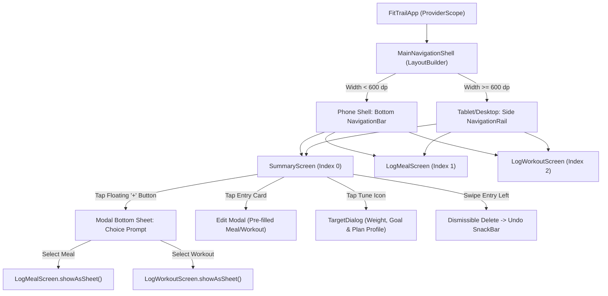
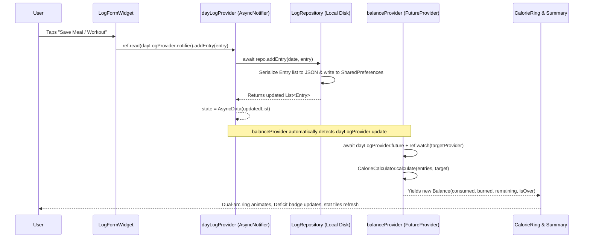

# FitTrail — Official Project Architecture & Technical Documentation

> **Application Name:** FitTrail (Personal Workout & Diet Tracker)  
> **Core Concept:** Real-time, offline-first calorie balance & deficit engine with responsive Material 3 design.  
> **Platform Targets:** Android, iOS, Web, macOS, Windows, Linux  

---

## 1. System Overview & Technology Stack

FitTrail is built with a unidirectional, reactive Clean Architecture pattern separating domain models, local persistence, pure calculation logic, reactive state providers, and presentation layers.

```
┌────────────────────────────────────────────────────────┐
│                   Presentation Layer                   │
│   (Screens, CustomPainter Widgets, Dialogs, Modals)    │
└───────────────────────────▲────────────────────────────┘
                            │ ref.watch() / ref.read()
┌───────────────────────────┴────────────────────────────┐
│                  Riverpod State Layer                  │
│    (selectedDateProvider, dayLogProvider,              │
│     balanceProvider, targetProvider, weightProvider)   │
└───────────────────────────▲────────────────────────────┘
                            │ Async calls
┌───────────────────────────┴────────────────────────────┐
│            Data Access & Business Logic Layer          │
│   (LogRepository, CalorieCalculator, MetCalculator)    │
└───────────────────────────▲────────────────────────────┘
                            │ I/O Serialization
┌───────────────────────────┴────────────────────────────┐
│                Persistent Storage Layer                │
│                 (shared_preferences)                   │
└────────────────────────────────────────────────────────┘
```

### Core Technologies & Libraries

| Technology / Package | Version / Type | Technical Purpose |
|---|---|---|
| **Flutter SDK** | `>=3.0.0` (Dart 3) | Cross-platform UI toolkit and runtime engine. |
| **`flutter_riverpod`** | `^2.6.1` / 3-compatible API | Compile-time safe state management using `AsyncNotifier`, `Notifier`, and `FutureProvider`. |
| **`shared_preferences`** | `^2.3.5` | Zero-latency asynchronous on-device key-value document persistence. |
| **`google_fonts`** | `^6.2.1` | Typography loading runtime for modern typography (`Outfit`). |
| **`intl`** | `^0.20.2` | Date formatting, calendar parsing, and time display. |
| **`uuid`** | `^4.5.1` | RFC4122 v4 collision-resistant unique ID generation for logged items. |

---

## 2. Navigation Architecture & Screen-to-Screen Flow

FitTrail operates an **Adaptive Hybrid Shell** architecture managed inside [lib/main.dart](file:///Users/sarthakkanade/FLUTTER_PROJECT/lib/main.dart).



### 1. Root Shell (`MainNavigationShell`)
- Uses `LayoutBuilder` to continuously monitor device width constraints.
- **Mobile (< 600 dp):** Mounts `Scaffold.bottomNavigationBar` with 3 `NavigationDestination` items (*Summary, Log Meal, Log Workout*).
- **Tablet / Desktop ($\ge$ 600 dp):** Mounts a persistent left `NavigationRail` alongside an `Expanded` content area.
- Uses `IndexedStack` to preserve screen scroll state and prevent costly widget teardowns when switching tabs.

### 2. Screen-to-Screen Journeys

#### A. The Summary Journey (Home)
- **File:** [lib/screens/summary_screen.dart](file:///Users/sarthakkanade/FLUTTER_PROJECT/lib/screens/summary_screen.dart)
- Displays current calendar date with date-stepping arrows (`<` and `>`), a calendar picker dialog, and a quick-return `"Today"` button.
- Subscribes to `balanceProvider` to render the animated dual-arc `CalorieRing`, the 3 stat tiles, and the alert status banner.
- Categorizes entries into two lists: **Meals** and **Workouts**.
- An extended `FloatingActionButton` opens a quick-selection bottom modal sheet (`_showAddChoiceSheet`) providing direct 1-tap access to either Meal or Workout loggers.

#### B. The Meal Logging Journey
- **File:** [lib/screens/log_meal_screen.dart](file:///Users/sarthakkanade/FLUTTER_PROJECT/lib/screens/log_meal_screen.dart)
- Accessible either as a standalone navigation tab or as a modal bottom sheet (`LogMealScreen.showAsSheet`).
- Features **Quick-Add Meal Chips** across the top: tapping any food pre-populates name, calories, and meal category.
- Form validation checks: food title non-empty, calories between 1 and 5,000.
- Category selection uses responsive `Wrap` + `ChoiceChip` elements.
- Live balance preview displays current remaining calorie budget before logging.
- Tapping **Save Meal** runs `dayLogProvider.notifier.addEntry(...)` asynchronously and pops/resets with a feedback SnackBar.

#### C. The Workout Logging Journey
- **File:** [lib/screens/log_workout_screen.dart](file:///Users/sarthakkanade/FLUTTER_PROJECT/lib/screens/log_workout_screen.dart)
- Accessible as a navigation tab or modal bottom sheet (`LogWorkoutScreen.showAsSheet`).
- Activity dropdown selects from 7 MET activities (*Walking, Running, Cycling, Gym, Yoga, Swimming, Other*).
- Duration is controlled via dual inputs: direct numeric input or an interactive continuous slider (5 to 120 mins) plus quick chips (15, 30, 45, 60, 90 mins).
- Dynamic calculation card displays real-time burned calorie estimates using user profile weight.
- Live projected deficit banner shows exact calorie deficit growth before saving.

---

## 3. Data Flow & Reactive State Management



### Riverpod Providers ([lib/providers/fitness_providers.dart](file:///Users/sarthakkanade/FLUTTER_PROJECT/lib/providers/fitness_providers.dart))

1. **`selectedDateProvider` (`Notifier<DateTime>`)**:
   - Stores the active calendar day (stripped of hours/minutes/seconds).
   - Exposes methods: `nextDay()`, `previousDay()`, `setDate(date)`, `setToday()`.
2. **`targetProvider` (`AsyncNotifier<int>`)**:
   - Manages daily calorie target budget (default: 2000 kcal).
   - Asynchronously loads from and writes to disk key `fittrail_target_kcal`.
3. **`weightProvider` (`AsyncNotifier<double>`)**:
   - Manages user weight in kg (default: 70.0 kg).
   - Feeds directly into `MetCalculator` to adjust exercise burn estimations.
4. **`dayLogProvider` (`AsyncNotifier<List<Entry>>`)**:
   - Listens to `selectedDateProvider`. When date changes, automatically reloads that date's log from disk.
   - Handles `addEntry`, `updateEntry`, `deleteEntry`, and `restoreEntry` (undo).
5. **`balanceProvider` (`FutureProvider<Balance>`)**:
   - Watches `dayLogProvider.future` and `targetProvider`.
   - Runs `CalorieCalculator.calculate(entries, target)` asynchronously.
   - Returns immutable `Balance` object exposed to `SummaryScreen`, `LogMealScreen`, and `LogWorkoutScreen`.
6. **`themeModeProvider` (`Notifier<ThemeMode>`)**:
   - Manages instant system/light/dark theme toggles.

---

## 4. Specialized & Custom Widgets

### 1. `CalorieRing` & `_DualRingPainter` ([lib/widgets/calorie_ring.dart](file:///Users/sarthakkanade/FLUTTER_PROJECT/lib/widgets/calorie_ring.dart))
- **Widget Type:** `StatefulWidget` with `SingleTickerProviderStateMixin` and `CustomPainter`.
- **Functionality:**
  - Implements dual concentric progress arcs using `Canvas.drawArc` and `Canvas.drawCircle`.
  - **Outer Arc (Blue `#0284C7`):** Represents food calories consumed vs target budget.
  - **Inner Arc (Orange `#F97316`):** Represents active workout calories burned.
  - **Center Typography:** Displays large `displayMedium` calories remaining in deficit or surplus.
  - **Deficit Status Badge:** Emerald Green (`#16A37F`) `"Deficit"` badge when on track; Warning Red (`#EF4444`) `"Surplus"` when budget is exceeded.
  - **Bottom Legend Bar:** Flexible 3-column legend breaking down Eaten, Burned, and Deficit.

### 2. `EntryCard` ([lib/widgets/entry_card.dart](file:///Users/sarthakkanade/FLUTTER_PROJECT/lib/widgets/entry_card.dart))
- **Widget Type:** `StatelessWidget` wrapping `Dismissible`, `Card`, and `InkWell`.
- **Functionality:**
  - Swiping right-to-left reveals a red delete action and triggers immediate removal.
  - Dispatches a floating SnackBar with an active **Undo** callback that restores the entry upon tap.
  - Tapping opens the item in pre-filled Edit mode.
  - Shows activity/food emoji, entry title, duration, time of day, and color-coded calorie pill badge.

### 3. `TargetDialog` ([lib/widgets/target_dialog.dart](file:///Users/sarthakkanade/FLUTTER_PROJECT/lib/widgets/target_dialog.dart))
- **Widget Type:** `ConsumerStatefulWidget` mounting an `AlertDialog`.
- **Functionality:**
  - Lets users set body weight and pick a preferred goal plan (*Fat Loss, Maintain, Muscle Gain*).
  - Dynamically calculates:
    $$\text{Maintenance} = \text{Weight (kg)} \times 30\text{ kcal}$$
    $$\text{Target Intake} = \text{Maintenance} + \text{Plan Offset}$$
  - Offers a 1-tap **Apply** button to prefill daily calorie targets.

### 4. `QuickMealChips` ([lib/widgets/quick_chips.dart](file:///Users/sarthakkanade/FLUTTER_PROJECT/lib/widgets/quick_chips.dart))
- **Widget Type:** `StatelessWidget` using horizontal `ListView.separated` and Material 3 `ActionChip`s.
- **Functionality:** 10 pre-configured common foods for instant form prefill.

### 5. `DateHeader` ([lib/widgets/date_header.dart](file:///Users/sarthakkanade/FLUTTER_PROJECT/lib/widgets/date_header.dart))
- **Widget Type:** `ConsumerWidget`.
- **Functionality:** Calendar date switcher supporting previous/next arrows, `showDatePicker`, and a smart relative date label (*"Today"*, *"Yesterday"*, *"Tomorrow"*).

---

## 5. Mathematical & Business Logic Models

### A. Calorie Balance Formula
$$\text{Remaining (Deficit)} = \text{Target Budget} - \text{Calories Eaten} + \text{Calories Burned}$$
- If $\text{Remaining} \ge 0$: User is in **Calorie Deficit** (`isDeficit = true`, `isOver = false`).
- If $\text{Remaining} < 0$: User has **Surplus / Target Exceeded** (`isOver = true`, `overAmount = Remaining.abs()`).

### B. Metabolic Equivalent of Task (MET) Formula
$$\text{Burned Calories (kcal)} = \text{MET} \times \text{Weight (kg)} \times \left(\frac{\text{Duration (min)}}{60}\right)$$

| Exercise Type | Standard MET Value | Burn for 70 kg (30 min) |
|---|---|---|
| Walking | 3.5 | 123 kcal |
| Running | 9.8 | 343 kcal |
| Cycling | 7.5 | 263 kcal |
| Gym / Weights | 5.0 | 175 kcal |
| Yoga | 3.0 | 105 kcal |
| Swimming | 6.0 | 210 kcal |
| Other | 4.0 | 140 kcal |

---

## 6. Local Storage Schema

Local storage is handled without external servers or cloud dependencies using `shared_preferences`. Data is indexed by discrete calendar date strings:

```json
Key: "fittrail_log_2026-10-03"
Value (JSON Array):
[
  {
    "id": "e3b0c442-98fc-1c14-9afb-4c72fe989f61",
    "type": "meal",
    "title": "Poha & Boiled Eggs",
    "kcal": 506,
    "createdAt": "2026-10-03T08:30:00.000Z",
    "mealType": "breakfast"
  },
  {
    "id": "c1a0d883-45cd-2e24-8bba-1d94fe123e42",
    "type": "workout",
    "title": "Morning Run",
    "kcal": 343,
    "createdAt": "2026-10-03T09:15:00.000Z",
    "exerciseType": "running",
    "durationMin": 30
  }
]
```

---

## 7. Testing & Quality Assurance

FitTrail includes automated unit and widget test suites inside `test/`:

- [test/calorie_calculator_test.dart](file:///Users/sarthakkanade/FLUTTER_PROJECT/test/calorie_calculator_test.dart): Verifies zero-state defaults, net remaining balance, over-target boundary triggers, calorie deficit calculation, and MET burn formulas.
- [test/widget_test.dart](file:///Users/sarthakkanade/FLUTTER_PROJECT/test/widget_test.dart): Verifies mobile layout rendering and tablet `NavigationRail` responsive adaptation.

Commands to verify test compliance:
```bash
flutter analyze
flutter test
```

---

## 8. Deployment Guide

### A. Web Deployment (GitHub Pages, Vercel, Firebase Hosting)

1. Build production release bundle:
   ```bash
   flutter build web --release --base-href "/"
   ```
2. The compiled assets are output to `build/web/`.
3. To test locally:
   ```bash
   npx serve build/web
   ```
4. Deploy to Firebase Hosting:
   ```bash
   firebase init hosting
   # Specify build/web as public directory
   firebase deploy --only hosting
   ```

### B. Android APK / App Bundle (Play Store)

1. Generate release APK:
   ```bash
   flutter build apk --release
   # Output: build/app/outputs/flutter-apk/app-release.apk
   ```
2. Generate Android App Bundle (AAB for Google Play):
   ```bash
   flutter build appbundle --release
   # Output: build/app/outputs/bundle/release/app-release.aab
   ```

### C. iOS Deployment (Apple App Store / TestFlight)

1. Build iOS archive:
   ```bash
   flutter build ipa --release
   # Output: build/ios/archive/Runner.xcarchive
   ```
2. Open in Xcode to sign with Apple Developer credentials and upload to TestFlight.

### D. Desktop Deployment (macOS, Windows, Linux)

```bash
# macOS
flutter build macos --release

# Windows
flutter build windows --release

# Linux
flutter build linux --release
```
